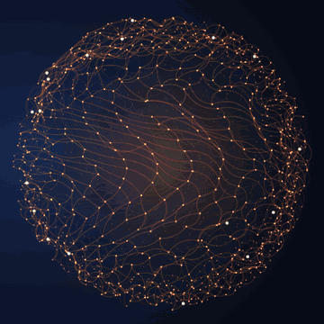
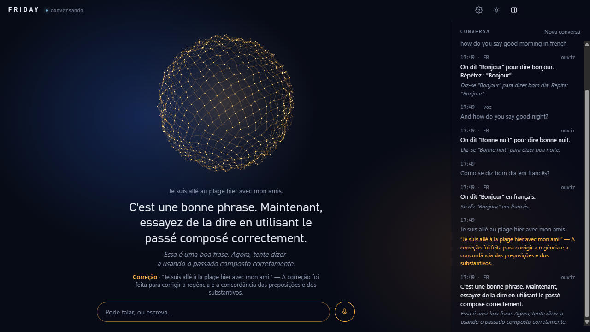
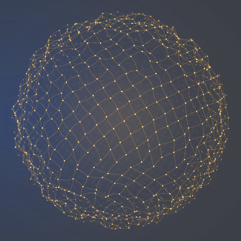
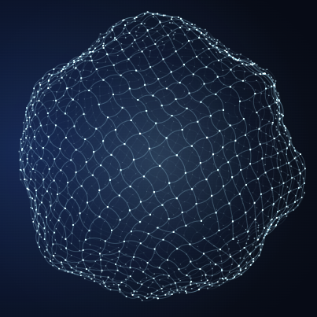
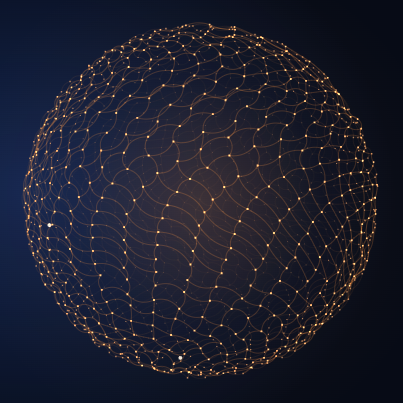
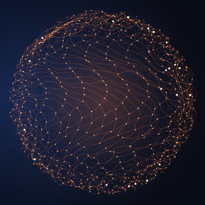
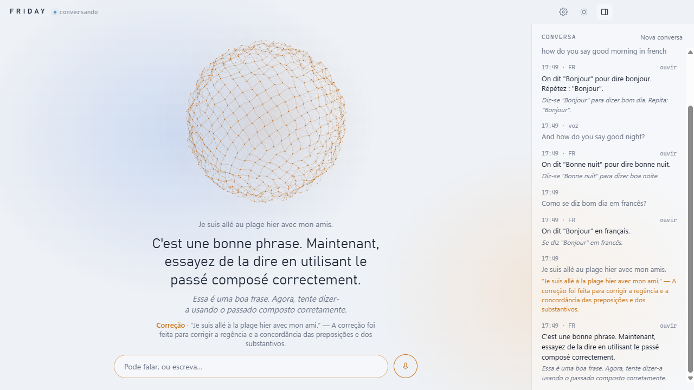
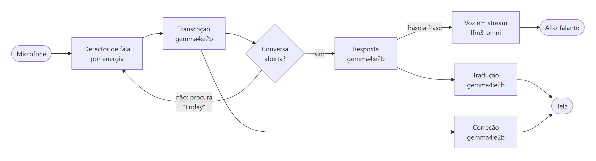
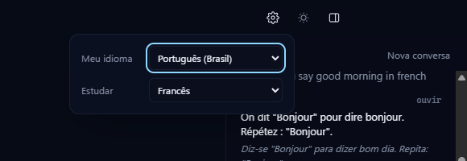

<div align="center">



# Friday

**Uma tutora de idiomas por voz que roda inteira no seu computador.**

Você conversa falando ou escrevendo. Ela responde em voz na língua que você estuda, mostra a tradução
na sua língua e corrige as suas frases, sem nuvem, sem conta e sem enviar nada para fora.

Electron · React · TypeScript · Ollama (gemma4:e2b + lfm3-omni)

</div>

<p align="center">
  
</p>

## O que ela faz

- **Conversa por voz em tempo real.** O microfone fica em espera desde que o app abre. Diga "Friday",
  "Sexta-feira" ou "Sexta" e a conversa começa; dali em diante é só falar, sem repetir o nome.
- **Espaço para construir sua fala.** A captura aguarda 3 segundos seguidos de silêncio e não encerra
  sua vez por duração. Falas longas são transcritas em trechos internos e viram uma única mensagem;
  a Friday só começa a responder depois de juntar tudo.
- **Fala sempre na língua que você estuda.** É o que você ouve e o que aparece em destaque. Logo abaixo
  vem a tradução na sua língua, só na tela, para você entender sem quebrar a imersão.
- **Corrige o que você diz.** Quando você fala ou escreve na língua de estudo, a frase corrigida aparece à
  parte, com a explicação na sua língua. Se não entender, pergunte, e ela explica.
- **Pode ser interrompida.** Fale por cima dela e ela para; o que você disse vira a próxima mensagem.
- **19 idiomas** de estudo e de uso, cada um com a voz nativa do lfm3-omni.
- **Tudo local.** Transcrição, conversa, correção, tradução e voz rodam no Ollama da sua máquina.

## A esfera

A esfera é o rosto da Friday: cerca de 1.400 nós ligados por fios elásticos, desenhados em canvas. Ela
reage ao estado real do app, e o volume do microfone e da voz dela mexe com a intensidade.

| Em espera | Ouvindo | Pensando | Falando |
|:---:|:---:|:---:|:---:|
|  |  |  |  |
| respira devagar | fica azul e treme com a sua voz | gira e solta faíscas pelos fios | pulsa no ritmo das sílabas |

<p align="center">
  
  <br><sub>Tema claro. O tema segue o do sistema, e o botão de sol alterna.</sub>
</p>

## Como funciona

<picture>
  <source media="(prefers-color-scheme: dark)" srcset="docs/images/architecture-dark.png">
  
</picture>

<sub>Fonte do diagrama: <a href="docs/architecture.mmd">docs/architecture.mmd</a> (Mermaid).</sub>

| Papel | Modelo | Como |
|---|---|---|
| Ouvir | `gemma4:e2b` | `POST /v1/audio/transcriptions`, trechos de até 28 s reunidos em uma transcrição por fala |
| Conversar | `gemma4:e2b` | `POST /api/chat` em stream interno, sem o modo "pensar"; o texto fica oculto durante a preparação |
| Traduzir a fala dela | `gemma4:e2b` | após preparar o áudio e apresentar a resposta |
| Corrigir a sua frase | `gemma4:e2b` | JSON com esquema fixo, após preparar o áudio |
| Falar | `lfm3-omni` | `POST /v1/audio/speech`; a resposta inteira toca depois de todo o áudio ficar pronto |

Detalhes que fazem diferença:

- **Tempo de fala e tamanho dos trechos são coisas separadas.** O Gemma 4 documenta até
  [30 segundos de áudio por entrada](https://ai.google.dev/gemma/docs/capabilities/audio).
  A captura fica aberta até 3 segundos de silêncio; depois, o app divide o áudio em trechos de até
  28 segundos, preferindo pequenas pausas. Quando não encontra uma pausa na borda, usa uma breve
  sobreposição e remove correspondências entre as transcrições. Esses trechos não disparam respostas
  separadas. Gravações mais longas consomem mais RAM e levam mais tempo para transcrever.
- **Texto e voz aparecem juntos.** A Friday gera o texto completo e depois prepara todo o áudio,
  mantendo a esfera e o indicador **Pensando…** durante as duas etapas. Só depois apresenta o texto
  e inicia a reprodução em um único buffer. A espera fica concentrada antes da resposta, evitando
  texto adiantado e pausas de geração entre as frases. Esc ou uma interrupção cancela a preparação
  sem revelar a resposta que ainda não foi apresentada.
- **Nenhuma regra é escrita por idioma.** A língua de cada mensagem é identificada por um detector
  estatístico ([`eld`](https://github.com/nitotm/efficient-language-detector-js)), não pelo modelo. Se uma
  explicação ou tradução vier na língua errada, o app pede de novo.
- **Contexto pequeno de propósito.** Na primeira vez que abre, o app cria duas variantes locais,
  `friday-brain` (8k) e `friday-voice` (4k), a partir dos modelos base. Com o contexto padrão de 128k,
  os dois modelos encheriam uma GPU de 6 GB e a voz ficaria mais lenta que o tempo real. As variantes
  reaproveitam os arquivos dos modelos, então nada é baixado.

## Requisitos

- [Ollama](https://ollama.com) rodando em `127.0.0.1:11434` (ou defina `OLLAMA_HOST`)
- Os dois modelos:
  ```sh
  ollama pull gemma4:e2b
  ollama pull lfm3-omni
  ```
- Node.js (testado com a versão 24)
- Uma GPU com cerca de 6 GB de VRAM (testado numa RTX 3050 de 6 GB). Fones de ouvido ajudam na conversa
  contínua, porque com caixas de som o eco da voz dela pode chegar ao microfone.

## Instalar e rodar

```sh
npm install
npm run dev               # desenvolvimento, com hot reload
npm run build && npm start
```

O Electron 45 baixa o executável no primeiro uso. Os comandos `npm run dev` e `npm start` executam
`install-electron` antes de abrir o app; a primeira execução precisa de internet. Se aparecer
`Error: Electron uninstall`, rode `npx --no install-electron` e tente novamente.

> Se o Electron abrir como Node puro ("Cannot read properties of undefined (reading 'whenReady')"), a
> variável `ELECTRON_RUN_AS_NODE` está definida no seu terminal. Isso acontece em terminais abertos por
> algumas extensões do VS Code; remova a variável antes de rodar.

## Como usar

1. **Escolha os idiomas** na engrenagem da barra de título: **Meu idioma** (o seu, português do Brasil por
   padrão) e **Estudar**. Também dá para trocar pedindo: "quero praticar espanhol".

   

2. **Abra a conversa** dizendo "Friday", "Sexta-feira" ou "Sexta", ou tocando na esfera. Um som curto
   confirma. Dá para fazer o pedido na mesma frase: *"Friday, como se diz bom dia em francês?"*. O nome
   só conta no começo da frase, então *"na sexta eu vou ao cinema"* não a chama.
3. **Converse.** Fale ou escreva na sua língua ou na de estudo. Ela sempre responde na de estudo, com a
   tradução embaixo; o que ela pedir para você repetir fica entre aspas e no original.
4. **Encerre** com uma despedida (*"tchau, Friday"*, *"obrigado, Sexta-feira, até logo"*), tocando na
   esfera de novo ou ficando 1 minuto em silêncio. Ela volta a esperar o nome.

Atalhos: **Esc** interrompe a fala; o botão do microfone liga e desliga a escuta; escrever funciona sempre.
O histórico fica no painel à direita e vale só enquanto o app está aberto.

## Diagnosticar pausas na voz

```sh
npm run diagnose
```

Com o Ollama aberto e os modelos `friday-brain` e `friday-voice` já criados pelo app, o comando mede
a voz sozinha, junto com chat e revisão, e com três frases enviadas ao mesmo tempo. Evite conversar
no app durante o teste. Usa texto sintético, sem gravar o microfone nem alterar os modelos.

O relatório fica em `out/diagnostics/voice-latest.json`. `realTimeFactor` acima de 1 significa que a
requisição levou mais tempo que a duração do áudio; em chamadas concorrentes, esse tempo também
inclui espera na fila. O relatório compara a espera para tocar a frase completa com os cortes
simulados do player anterior (`legacyStreaming`), sem medir a reprodução no Electron.
Para testar outra voz, defina `FRIDAY_DIAG_SPEAKER` (por exemplo,
`female-french`). `FRIDAY_DIAG_BRAIN` e `FRIDAY_DIAG_VOICE` permitem escolher os modelos do diagnóstico.

Veja o [diagnóstico desta máquina em 29/10/2026](docs/diagnostico-voz.md).

Para verificar os estados, a fila e os cancelamentos sem usar modelos ou microfone:

```sh
npm run test:audio            # player, captura longa e divisão/transcrição com áudio simulado
npm run test:audio:electron   # interface real e Web Audio em janela oculta, com áudio sintético silencioso
```

No console do renderer, os registros `[Friday áudio]` mostram agendamento, estados e motivo de
parada (`microphone`, `escape`, `orb`, `replay` ou `new-reply`), sem registrar o texto das falas.
Se houver um corte por detecção do microfone, ele aparece como `stop` com motivo `microphone`.

## Medir a qualidade

```sh
npm run eval                      # modelo padrão (friday-brain)
npm run eval -- outro-modelo      # compara outro modelo do Ollama
```

O script roda os casos de [`scripts/eval-cases.ts`](scripts/eval-cases.ts) com as mesmas funções do app
e mostra o resultado de cada etapa. Última medição (29/10/2026, gemma4:e2b):

| Medida | Resultado |
|---|---|
| Língua da mensagem identificada | 14/14 |
| Erros pegos | 10/13 (77%) |
| Alarmes falsos em frases corretas | 0/7 |
| Explicação da correção na língua do aluno | 10/10 |
| Fala na língua de estudo | 8/8 |
| Tradução na língua do aluno | 8/8 |

## Estrutura

```
src/
  main/        processo principal: janela, IPC e cliente do Ollama
  preload/     ponte segura entre a janela e o processo principal
  renderer/src/
    audio/     microfone sempre aberto, detector de fala, voz em stream
    orb/       a esfera de partículas
    lib/       prompts, idiomas, palavra de ativação, revisão e tradução
    components/
scripts/       medição dos prompts (npm run eval)
docs/          ideia original, plano e imagens deste README
```

Variáveis opcionais: `OLLAMA_HOST`, `FRIDAY_CHAT_MODEL` (modelo base de transcrição e conversa; precisa
entender áudio) e `FRIDAY_TTS_MODEL` (modelo base da voz).

## Limitações conhecidas

- O modelo de conversa é pequeno (5B, quantizado): cerca de 1 em cada 4 erros passa sem correção, e
  algumas explicações são genéricas.
- A primeira fala depois de abrir o app leva alguns segundos, enquanto os modelos carregam.
- A detecção de fala é por energia: num ambiente barulhento, ruídos fortes podem virar falas curtas.
- A interface está em português.

## Créditos

- Modelos: [Gemma 4](https://ai.google.dev/gemma) (Google) e [LFM](https://www.liquid.ai) (Liquid AI),
  servidos pelo [Ollama](https://ollama.com).
- Detecção de idioma: [eld](https://github.com/nitotm/efficient-language-detector-js).
- O nome e a ideia da esfera são uma homenagem às assistentes de IA dos filmes. Este é um projeto pessoal,
  sem relação com a Marvel ou a Disney.
